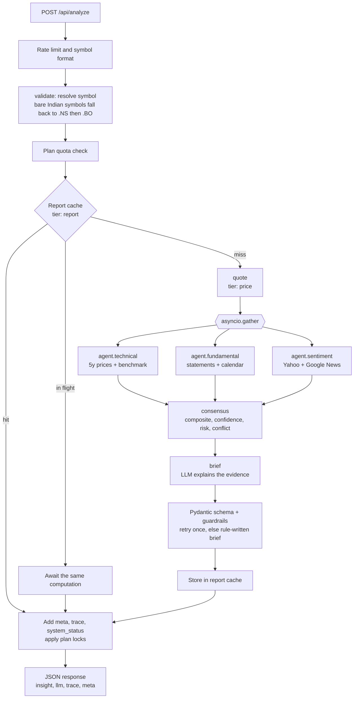
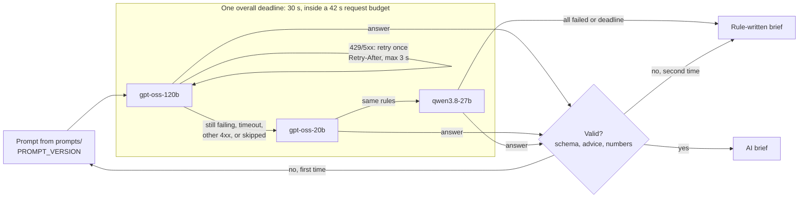
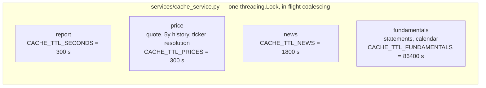

# Quantum architecture (v2.1.0)

Quantum turns a stock ticker into a research report. Every score is calculated by fixed rules; a language model only writes the explanation, and its answer is checked before anyone sees it.

- **Backend:** FastAPI on Render, Python 3.11, one Uvicorn worker.
- **Frontend:** React 19 + Vite on Vercel.
- **Data:** yfinance (prices, statements, calendar) and Google News RSS.
- **Language model:** Groq.

## Request flow

`POST /api/analyze` is async end to end. Blocking work (yfinance, pandas) runs in worker threads through `asyncio.to_thread`; HTTP calls to Groq and Google News use `httpx.AsyncClient`.

- **Code:** `api/routes.py` (`analyze_stock`), `services/pipeline.py` (`build_report`, `_consensus`), `agents/base.py` (Agent interface and the three agents), `services/research_engine.py` (scoring), `agents/master_agent.py` (brief).
- **Agent interface:** `async run(evidence, ctx) -> AgentResult(name, status, score, data, error)`. An agent that raises becomes `status="error"`; the consensus step re-weights without it. Only the technical agent is required.

## Model fallback chain

- **Skipping (`RateLimitTracker`):** a model is skipped while it is cooling down after a 429, or when Groq's last `x-ratelimit-remaining-tokens` is below what this prompt needs and its window has not reset.
- **Recovery:** once the cooldown or reset time passes, the model is used again.
- **Code:** `services/llm_service.py` (`generate`, `RateLimitTracker`, `model_chain`).

## Cache tiers

- `get_or_compute(tier, key, factory)`: the first caller computes; concurrent callers for the same key await the same future, so identical requests compute once.
- Report and news values are deep-copied on read.
- Hits, misses and coalesced waits are counted per tier and shown at `GET /api/admin/usage`.
- **Limit:** in process memory only. The cache is empty after a restart and not shared between instances.

## Trace spans

Each request gets a `request_id` and a `Trace` held in `contextvars`, so spans recorded inside `asyncio.gather` tasks and `to_thread` workers belong to the right request.

```mermaid
gantt
    title Spans for one uncached report (illustrative timings)
    dateFormat X
    axisFormat %L ms
    section request
    validate            :0, 700
    report              :700, 9000
    section report
    quote               :700, 3300
    agent.technical     :3300, 4000
    agent.fundamental   :3300, 5900
    agent.sentiment     :3300, 4500
    consensus           :5900, 5910
    brief               :5910, 9000
    llm.generate#1      :5910, 9000
```

- **Span fields:** name, start_ms and end_ms from the request start, duration_ms, status, error, attributes (cache source, agent score, model, tokens).
- **Where spans go:** returned in the response as `trace`, written to the logs as JSON (`type: span`), and the last 200 traces are kept at `GET /api/admin/traces`.
- On a cache hit, the response trace shows this request's spans plus `generation_spans` from the request that built the report.

## Observability

| Signal | Where |
| :-- | :-- |
| Per-call model, status, tokens, latency, fallback step | JSON log line `type: llm_call`; `llm.attempts` in the response |
| Per-report model, prompt version, tokens, latency, fallback, outcome | `llm` in the response; JSON log line `type: brief` |
| Daily totals per model, brief outcomes, cache hit rates, Groq rate-limit state | `GET /api/admin/usage` (header `x-admin-token`) |
| Last 200 request traces | `GET /api/admin/traces` (header `x-admin-token`) |
| Every log line | JSON with `request_id` and `prompt_version` (`core/logging_setup.py`); `LOG_FORMAT=text` for local reading |

Usage aggregates and traces are in memory, so they reset on restart.

## Guardrails on the brief

1. The prompt contains only calculated evidence and forbids outside facts, advice and forecasts.
2. The answer must parse into the Pydantic `Brief` model: lengths, 2–6 key drivers, 2–5 points per case, 1–6 risk items with `Low/Medium/High` levels.
3. It is rejected for advice wording (`ADVICE_PATTERN`) or more than two numbers not found in the evidence.
4. A rejected answer is retried once with the reason; a second failure uses the rule-written brief.
5. A conflicted report always says "Mixed signals".
